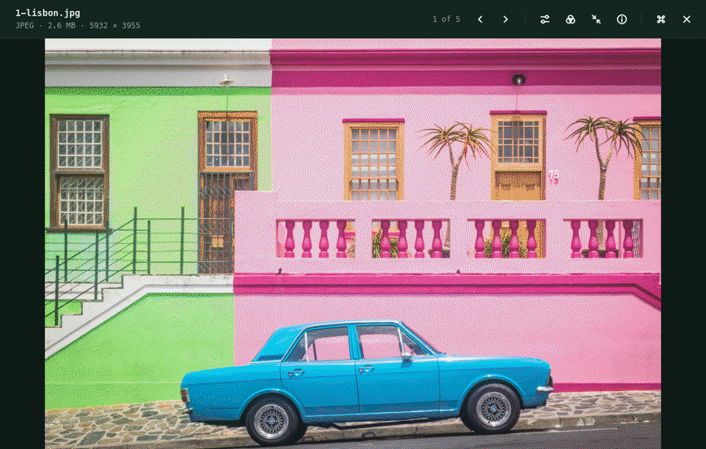

<p align="center">
  
</p>

<h1 align="center">Diapo</h1>

<p align="center">
  <b>A photo viewer for <a href="https://omarchy.org">Omarchy</a>.</b><br>
  One quiet window that opens every photo format, with film looks, an editor and a compressor.
</p>

<p align="center">
  
</p>

Diapo follows the Omarchy theme, corner rounding and language live, and opens
floating over the Files window you clicked the photo in, rather than as a tile
of its own. Drag it by its title to slide it aside.

- **View** JPEG, PNG, WebP, GIF, AVIF, HEIC, JPEG XL, TIFF, SVG, BMP, ICO, TGA
  and camera RAW (CR2, CR3, NEF, ARW, DNG, RAF, ORF, RW2 and more).
- **Edit** crop, rotate, flip, straighten, light and colour, grain and
  vignette. The original is never changed; saving writes a copy beside it.
- **Looks** 30 film looks after Leica, Fujifilm and Kodak renderings.
- **Compress** to WebP, AVIF, JPEG XL, JPEG or PNG with a live size and a
  before/after line. When it is done a popup asks where to save.

## Install on Omarchy

Diapo is built from source; it takes about a minute.

**1. Install what it needs to build** (most of it is already on Omarchy):

```sh
sudo pacman -S --needed base-devel git cmake qt6-base qt6-declarative qt6-svg \
  qt6-imageformats qt6-wayland libheif libjxl libraw
```

**2. Download, build and install it** for your user (into `~/.local`, no root needed):

```sh
git clone https://github.com/Profit94/diapo.git ~/.local/src/diapo
cd ~/.local/src/diapo
bin/build
cmake --install build --prefix ~/.local
```

Diapo now shows up in the app launcher (Super + Space), and `diapo photo.jpg`
works in a terminal.

**3. Make it the app that opens your photos** (optional, so clicking a photo
in Files opens Diapo):

```sh
xdg-mime default diapo.desktop $(grep ^MimeType= ~/.local/share/applications/diapo.desktop | cut -d= -f2 | tr ';' ' ')
```

### Update

```sh
cd ~/.local/src/diapo && git pull && bin/build && cmake --install build --prefix ~/.local
```

### Remove

```sh
rm ~/.local/bin/diapo ~/.local/share/applications/diapo.desktop \
   ~/.local/share/icons/hicolor/scalable/apps/diapo.svg
rm -r ~/.local/share/licenses/diapo ~/.local/src/diapo
```

Photos then open with whatever app you choose next in Files.

## Build and test

    bin/build                                 # into build/
    bin/test                                  # the tests, offscreen
    cmake --install build --prefix ~/.local   # into the app launcher

## Shortcuts

| Key | Does |
| --- | --- |
| Space, → | Next photo |
| Backspace, ← | Previous photo |
| Home, End | First and last photo |
| + − 0 1 | Zoom in, out, fit, actual size |
| F | Full screen |
| I | Details |
| E | Edit |
| L | Looks |
| C | Compress |
| [ ] | Rotate (while editing) |
| \ | Hold to see the original (while editing) |
| Ctrl+S | Save a copy (while editing) |
| Ctrl+Z, Ctrl+Shift+Z | Undo, redo |
| Ctrl+C | Copy the photo |
| Ctrl+O | Open a photo |
| Delete | Move to the trash |
| Esc | Go back |
| ? | Show the shortcuts |
| Q | Quit |

## Without a window

    diapo compress photo.jpg --format webp --quality 80 --max 2560 --json
    diapo look photo.jpg --name "Classic Chrome" --strength 80
    diapo looks

Each exits 0, or 1 with the reason on stderr.

## License

Diapo is free to install and use, and pull requests are welcome, but it is not
open source: you may not copy, redistribute or reuse its code, icon, looks or
visual design. See [LICENSE](LICENSE). Parts that come from Omarchy's own apps
keep their MIT license, as listed there.

Demo photos from Unsplash: Claudio Fonte, John Fowler, Dominik Dombrowski and
Oziel Gómez.
